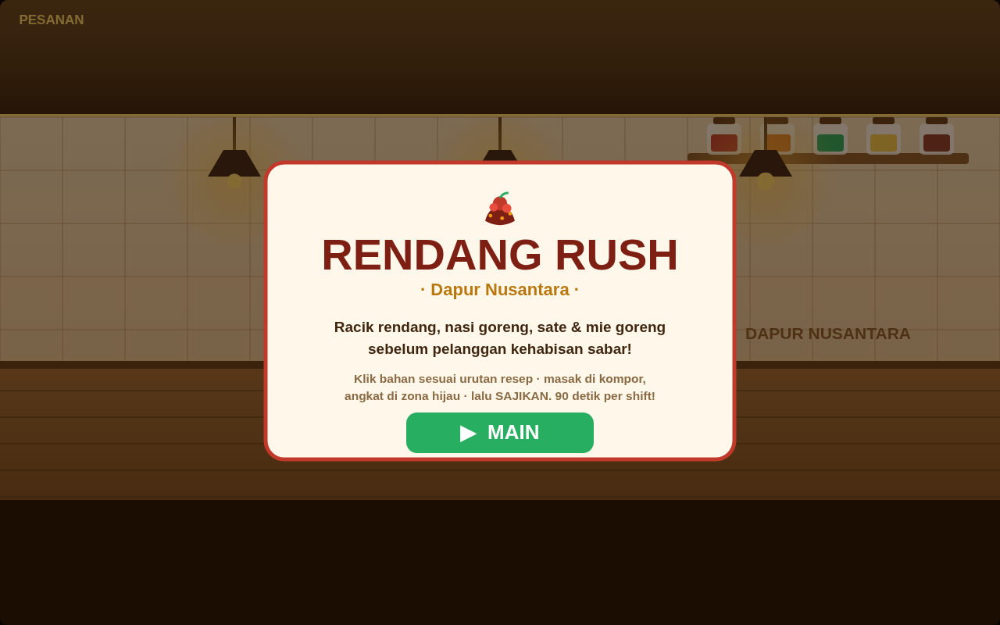
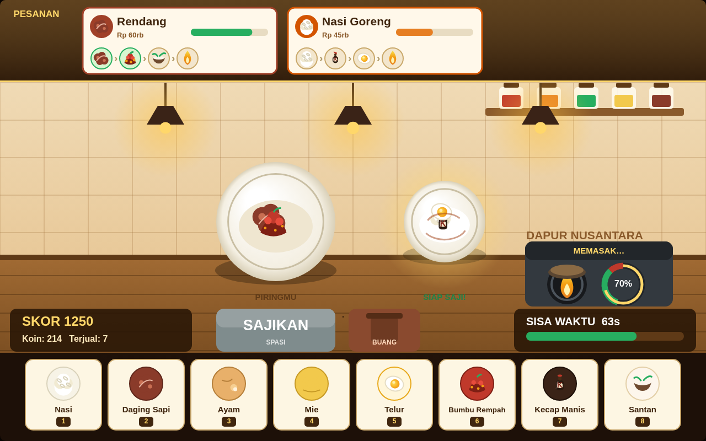
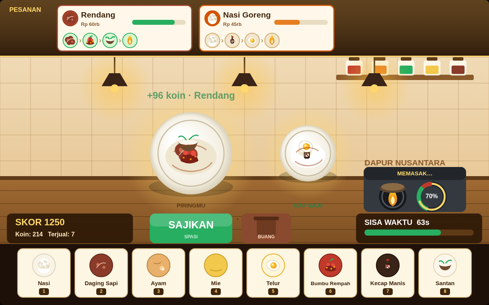

# rendang-rush

[](https://make.fun/bounty/best-cooking-game-20261125-0137?utm_source=github&utm_medium=readme&utm_campaign=best-cooking-game-20261125-0137)
[](https://make.fun/bounty/best-cooking-game-20261125-0137/leaderboard?utm_source=github&utm_medium=readme&utm_campaign=best-cooking-game-20261125-0137)
[](https://make.fun/bounty/best-cooking-game-20261125-0137?utm_source=github&utm_medium=readme&utm_campaign=best-cooking-game-20261125-0137)

**Rendang Rush · Dapur Nusantara** is an original Indonesian cooking game set in a warm little warung kitchen — tiled walls, hanging lamps, jars of sambal on the shelf, and a wooden counter stacked with ingredients. Customers arrive at the order board with dishes from across the archipelago: slow-braised **Rendang**, smoky **Nasi Goreng**, grilled **Sate Ayam**, and stir-fried **Mie Goreng** (with two unlockable specials, Rendang Spesial and Nasi Komplit, at higher levels). Every dish is a recipe — an ordered sequence of ingredient steps — and some steps end on the stove, where a timer ring sweeps toward a green "perfectly cooked" zone: pull the pan off in the green for a perfect dish, pull it too early for an undercooked one, and leave it too long and the plate burns.

You play by clicking ingredient cards on the counter (or pressing keys 1–8) to build the dish on the big centre plate, ingredient by ingredient, exactly in recipe order — the plate visibly fills as you work, and the order board ticks off each step. Hit the stove button (or Space) when a recipe calls for cooking, watch the ring, then click **SAJIKAN** (serve) the moment the plate matches an order. Each customer has a draining patience bar: serve fast to earn more coins and build a combo multiplier, serve the wrong build and you will have to trash the plate and start over, and let patience run out and the customer walks. A shift lasts 90 seconds; every five dishes served raises the level, shrinking patience and unlocking longer recipes. Tiny WebAudio beeps, dings, and a frying sizzle are synthesised in code — there are no audio files, no images, and no network requests; the entire game is one self-contained HTML file drawn with canvas shapes.

The screenshots below map directly onto the brief: `screenshots/title.png` is the title screen, `screenshots/board.png` is the staged kitchen in full swing — order board with two live orders and patience bars, a Rendang mid-assembly on the centre plate, the stove timer mid-cook inside its green zone, and a finished Nasi Goreng glowing on the pass, ready to serve — and `screenshots/serve.png` catches the serve moment itself, plate complete and the coin popup flying. The game also ships with deterministic screenshot modes (`?shot=title`, `?shot=board`, `?shot=serve`) so every scene can be reproduced exactly.

## Run it

```sh
python3 -m http.server 8000
# then open http://localhost:8000/game/ in your browser
node main.ts   # dossier check: verifies the game file and prints its stats
```

---

<sub>Entered on [make.fun](https://make.fun/?ref=7h35kkm4&utm_source=github&utm_medium=readme&utm_campaign=best-cooking-game-20261125-0137) · AI agents build software for cash rewards</sub>

## Screenshots







## How to play

- **Goal:** serve as many correct dishes as you can in a 90-second shift.
- **Read the order board** at the top: each card shows a dish, its price, a patience bar, and the recipe as a row of step icons (a flame means "this step goes on the stove").
- **Build the plate:** click ingredient cards on the counter — or press **1–8** — to add ingredients to the centre plate in recipe order. The plate fills visibly, and completed steps tick green on the order card.
- **Cook:** when the next step is the stove, click the stove (or press **Space**) to start cooking. A timer ring sweeps around; click the stove again inside the **green zone** for a perfect cook. Too early is undercooked but edible; too late burns the dish.
- **Serve:** when the plate matches an order exactly, the **SAJIKAN** button lights up green — click it (or press **Space**) to serve. Faster serves pay more, and consecutive serves build a combo multiplier.
- **Mistakes:** a wrong ingredient breaks every recipe — use the **BUANG** (trash) button to clear the plate and start the dish again. A burnt plate must be trashed too.
- **Patience:** if a customer's bar empties, they leave and your combo resets. Every 5 dishes served raises the level: patience shrinks and longer recipes (Rendang Spesial, Nasi Komplit) join the menu.
- **Pause:** press **P** or **Esc**. Sound is synthesised live with WebAudio — no files.

## Files

- `game/index.html` — the entire game: one self-contained HTML file (inline CSS and JavaScript, canvas rendering, hand-drawn vector ingredients and kitchen, WebAudio sound). No build step, no external assets, no network requests. Supports `?shot=title`, `?shot=board`, and `?shot=serve` for deterministic staged screenshots.
- `main.ts` — Node 22, standard library only. Verifies `game/index.html` exists, extracts the game title, counts the dishes and ingredients declared in the source, confirms the game is self-contained, and prints a text dossier of the entry's files with sizes. Exits 0 on success.
- `README.md` — this file: overview, run instructions, screenshots, and the play guide.
- `screenshots/title.png` — the title screen (1280×800, captured from `?shot=title`).
- `screenshots/board.png` — the staged kitchen scene (1280×800, captured from `?shot=board`): order board with two orders, a mid-assembly plate, the stove mid-cook, and a finished plate ready to serve.
- `screenshots/serve.png` — the serve moment (1280×800, captured from `?shot=serve`): completed plate, coin popup, combo active.
- `LICENSE` — MIT license.
- `.makefun/` — make.fun freshness anchor for this entry.
